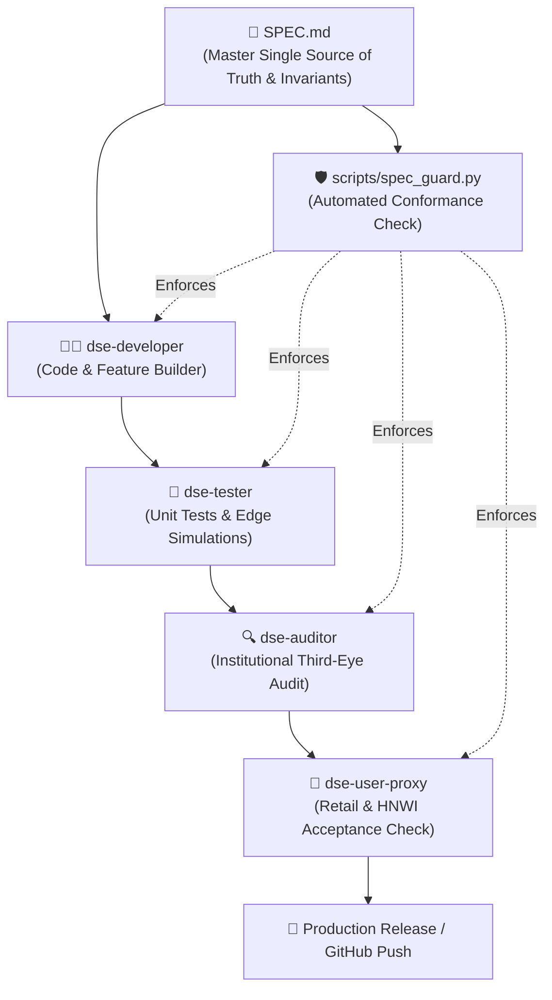

# 📈 stock_market_expert_bd
### Autonomous DSE Quantitative Engine, Anti-Manipulation Surveillance & AI Financial Intelligence System

[](https://www.python.org/downloads/)
[]()
[]()
[]()
[-gold.svg)]()
[]()
[]()
[]()

`stock_market_expert_bd` is an institutional-grade algorithmic quantitative finance platform and autonomous financial advisor designed specifically for the Dhaka Stock Exchange (DSE) and Bangladesh capital markets.

Operating with the disciplined mathematical standards of leading quantitative asset managers, the platform combines **strict Point-in-Time (PIT) financial accounting**, **central bank macro hurdle rates**, **forensic syndicate pump surveillance**, **tri-horizon risk-parity portfolio allocation**, and an **immutable hash-chained forward test ledger**.

---

## 🚀 Quick Start (Instant Zero-Broken Setup in 3 Seconds)

The entire system is packaged with a single-word self-healing bootstrap engine. Anyone on Windows, Linux, or macOS can clone and run immediately without missing dependencies or broken database states.

### 1. Clone the Repository (Ultra-Fast ~35 MB)
```bash
git clone https://github.com/ashik1291/stock_market_expert_bd.git
cd stock_market_expert_bd
```

### 2. Run One-Click Bootstrap
- **Windows (Double-Click or CMD)**:
  ```cmd
  ready.bat
  ```
- **Windows PowerShell**:
  ```powershell
  .\ready.ps1
  ```
- **Linux / macOS**:
  ```bash
  chmod +x ready.sh
  ./ready.sh
  ```
- **Direct Python on Any Platform**:
  ```bash
  python scripts/bootstrap.py
  ```

#### What Bootstrap Does Automatically:
1. **Python Dependencies**: Verifies packages from `requirements.txt` (`requests`, `beautifulsoup4`, `lxml`, `matplotlib`, `pandas`, `bdshare`, `pdfplumber`). Auto-installs if missing.
2. **Database Auto-Restoration**: Verifies `data/processed/dse.db`. On a fresh clone, automatically decompresses the master PIT archive (`dse.db.gz`, 30 MB) into the full uncompressed database (138 MB, 1,090,956 historical price bars, 5,570 continuous trading sessions).
3. **Configuration Verification**: Validates 12-factor company registries, sector maps, and threshold manifests.
4. **Heartbeat Sync**: Pulls latest macro benchmark rates (11.60% 91-day T-Bill) and synchronizes daily market close disclosures.
5. **Readiness Dashboard**: Confirms 100% operational readiness.

---

## 📤 How to Push This Repository to GitHub

This repository has been fully optimized for GitHub:
- **No Git LFS Required**: Zero Git LFS quota issues, zero bandwidth bottlenecks.
- **Minimal Repository Size**: All files are under 31 MB (far below GitHub's 100 MB hard limit and 50 MB warning threshold).
- **Clean `.gitignore`**: Temporary caches, scratch scripts, backups (`*.bak`), and bulky uncompressed binaries are safely excluded.

To push this codebase to your own GitHub account:

```bash
# 1. Create a new empty repository on GitHub (e.g., 'stock_market_expert_bd')
# Do NOT initialize with README, license, or .gitignore (they are already included).

# 2. Add your GitHub remote repository URL:
git remote add origin https://github.com/ashik1291/stock_market_expert_bd.git

# 3. Rename branch to master (or main if preferred):
git branch -M master

# 4. Push cleanly in seconds:
git push -u origin master
```

---

## 🏛️ Core Philosophy: The Subtractive Edge

In emerging equity markets like Bangladesh, the primary driver of quantitative outperformance is not trying to predict short-term price noise. **The true edge is subtractive: eliminating the 90% toxic companies** on the exchange:
- ❌ **Debt Traps**: High long-term loan burdens destroyed by 12%–14% commercial bank borrowing costs.
- ❌ **Accrual / Paper Earnings**: Companies reporting positive EPS while operating cash flow (NOCFPS) is negative.
- ❌ **Retail Distribution Traps**: Speculative penny stocks pumped by syndicate social media channels without fundamental earnings.
- ❌ **Corporate Governance Probes**: Companies flagged with receiver appointments, pending BSEC investigations, or sponsor share pledging.

By filtering out the 90% worst stocks, capital is concentrated exclusively in **resilient, cash-covered moats** trading with a quantifiable **Graham Margin of Safety**.

---

## 💻 Master CLI Command Reference

Execute commands through the master controller:

```bash
# 1. Full System Status & Macro Health Dashboard
python main.py status

# 2. Daily Directional Rise/Fall Predictive Scanner
python main.py scan

# 3. 12-Factor Graham/Buffett Screener (Top 2 Stocks per Sector)
python main.py best2

# 4. Generate Exact Capital Deployment Plan (e.g. BDT 50,000)
python main.py plan 50000

# 5. Audit Real Portfolio Holdings, Mark-to-Market & P&L
python main.py portfolio

# 6. Run Daily Statistical Alpha Cycle & Bayesian Calibration
python main.py alpha

# 7. End-to-End Daily Pipeline Execution (16 Stages)
run_daily.bat
# or
python scripts/run_daily_pipeline.py
```

---


---

## 📜 SpecMD & Multi-Agent Architecture

To prevent architectural drift and ensure institutional invariants are never compromised during updates, the system implements a strict **Spec-Driven Multi-Agent Protocol**:



| Agent Role | Skill Location | Primary Mandate |
| :--- | :--- | :--- |
| **Developer** | `.agents/skills/dse-developer/` | Feature implementation, PEP8, universal SQLite WAL timeouts, PIT assertions |
| **Tester** | `.agents/skills/dse-tester/` | Regression gatekeeper, 77/77 unit tests, 9/9 integrity checks, edge simulations |
| **Auditor** | `.agents/skills/dse-auditor/` | Institutional third-eye audit, bias detection, 100-pt scoring (Score >= 95.0) |
| **User Proxy**| `.agents/skills/dse-user-proxy/`| Real investor simulation (৳1,000 retail, ৳50k swing, ৳1M HNWI), Bengali clarity |

### Automated Invariant Verification
Run the spec conformance guard at any time:
```bash
python scripts/spec_guard.py
```

## ⚙️ Automated 16-Stage Daily Master Pipeline

The engine executes an end-to-end autonomous daily cycle upon market close:

```
[Bangladesh Bank Scraper] ────────┐
                                  ▼
                        [Stage 1: Macro Rates] (91d T-Bill 11.60%, Repo 10.00%)
                                  │
[DSE / bdshare Live Scrape] ──────┼─────────► [Stage 2: Multi-Source Scraper Failover]
                                  │           (bdshare -> Next.js API -> Legacy -> Cache)
                                  ▼
                        [Stage 3: SQLite Processing & PIT Ingestion] (dse.db)
                                  │
                        [Stage 4: Anti-Manipulation Surveillance] (395 Tickers)
                                  │           (Volume Anomaly Ratio >= 3x, BSEC Probes)
                                  ▼
                        [Stage 5: 5-Factor Fundamental Screener]
                                  │           (Graham Value, Audited NOCFPS, Moats)
                                  ▼
                        [Stage 6: Daily Rise/Fall Directional Predictions] (Bilingual)
                                  │
                        [Stage 7: Corporate Actions & Dividend Catalysts] (PSI Notices)
                                  │
                        [Stage 8: Tri-Horizon Recommendations & Visual Charts]
                                  │           (Long-Term Assets, Mid-Term Swings, Scalps)
                                  ▼
                        [Stage 9: Monthly Rebalance & Risk Parity Engine]
                                  │           (20% Sector Concentration Limit, 10% Cash)
                                  ▼
                        [Stage 10: Dividend Accounting & Cash Disbursements]
                                  │
                        [Stage 11: Forward Test Ledger Advance & SHA-256 Stamping]
                                  │
                        [Stage 12: Open-End Mutual Fund Mark-to-Market NAV Sync]
                                  │
                        [Stage 13: Real Portfolio Auditing & Break-even Tracking]
                                  │
                        [Stage 14: Real-Time Portfolio Sentinel & Floor Price Guards]
                                  │           (+15% / +30% Take-Profit, Circuit Breakers)
                                  ▼
                        [Stage 15: Chief Financial Advisor Executive Dossier] (Bilingual)
                                  │
                        [Stage 16: Zero-Leakage Integrity Harness & Data Freshness]
```

---

## 🔬 Core Quantitative Engines & Architecture

### 1. Macro Dynamic Hurdle Rate & ERP Engine ([`macro_rate_feed.py`](file:///c:/Users/BS01671/Documents/stock_market/scripts/macro_rate_feed.py))
- Integrates Bangladesh Bank monetary indicators: **Policy Repo Rate (10.00%)**, **Interbank Call Money (9.75%)**, **Headline Inflation (9.92%)**, and **91-Day T-Bill Auction Yield (11.60%)**.
- Computes real-time **Equity Risk Premium (ERP)**: $\text{ERP} = \text{Earnings Yield} - R_f$.
- Blocks any stock whose earnings yield fails to beat sovereign risk-free paper plus a minimum required spread of +350 bps.

### 2. Forensic Anti-Manipulation & BSEC Surveillance ([`anti_manipulation_engine.py`](file:///c:/Users/BS01671/Documents/stock_market/scripts/anti_manipulation_engine.py))
- Scans all 395 listed tickers daily for **Volume Anomaly Ratio (VAR $\ge 3.0\times$)** and **Corwin-Schultz Bid-Ask Spread widening**.
- Flags speculative pump-and-dump junk and tracks official BSEC regulatory probes directly into `is_ticker_blacklisted(ticker, asof_date)`.
- Propagates strictly with point-in-time `asof_date` to prevent historical lookahead contamination.

### 3. Point-in-Time (PIT) 5-Factor Fundamental Screener ([`five_factor_fundamental_screener.py`](file:///c:/Users/BS01671/Documents/stock_market/scripts/five_factor_fundamental_screener.py))
- Strictly isolates financial statements by `(tradable_date <= asof OR publication_date <= asof)`.
- Computes **Graham Fair Value** ($\sqrt{22.5 \times \text{EPS} \times \text{NAV}}$) and required Margin of Safety.
- Enforces audited cash quality: **Consolidated NOCFPS / EPS $\ge 0.75\times$** and **Debt/Equity $\le 0.80$**.

### 4. Tri-Horizon Asset Allocator & Sector Concentration ([`recommender.py`](file:///c:/Users/BS01671/Documents/stock_market/scripts/recommender.py))
- Segregates actionable ideas into three disciplined horizons:
  - **🏛️ Long-Term Core Moats (60% capital)**: 1–5+ year horizon, defensive balance sheets, audited cash-flow dividends.
  - **📈 Mid-Term Cycle Swings (30% capital)**: 12%–20% target profit swings with trailing stops.
  - **🛡️ Tactical Cash Reserve (10% capital)**: Dry-powder buffer reserved for deep oversold RSI (<25) panics.
- **20% Sector Concentration Limit**: Restricts top allocations to a maximum of 2 stocks per sector to prevent industry clustering.

### 5. Real-Time Portfolio Sentinel & Execution Playbook ([`portfolio_sentinel.py`](file:///c:/Users/BS01671/Documents/stock_market/scripts/portfolio_sentinel.py))
- Real-time mark-to-market position tracking with exact break-even calculations (including 0.415% buy / 0.465% sell statutory fees and slippage).
- **Lower Circuit Breaker Trap Detector**: Recognizes zero-bid lower circuit lockups (-10% or -3%) and defers exit execution until liquid sessions.
- **Automated Profit-Taking**:
  - `TAKE_PROFIT_ALL`: Automatically triggers when target price is reached or P&L $\ge +30\%$.
  - `TAKE_PROFIT_HALF`: Automatically locks in 50% profit at $+15\%$, trailing remaining balance to break-even.

### 6. Reinforcement Learning & Hash-Chained Forward Ledger ([`reinforcement_learning_engine.py`](file:///c:/Users/BS01671/Documents/stock_market/scripts/reinforcement_learning_engine.py))
- Evaluates directional predictions against actual closing prices with empirical Brier calibration.
- Updates factor weights via **Empirical Bayes shrinkage** towards neutral priors.
- Logs daily portfolio NAV, cash balances, and positions into an immutable cryptographic SHA-256 block-stamped ledger (`forward_test_ledger_v2.json`).

---

## 🧪 Verification & Test Suite

The engine is covered by an extensive, non-regressive institutional test suite:

```bash
# Run all 68 unit tests
python -m unittest discover -s tests -p "test_*.py"

# Run standalone integrity harness & leakage verification
python scripts/integrity_harness.py
```

**Test Verification Status**:
- **68/68 Unit Tests Passing** (`tests/test_audit_fixes_validation.py`, `tests/test_quant_engine.py`)
- **9/9 Integrity Harness Checks Passing** (`scripts/integrity_harness.py`)
- **Champion Model Hash**: `acf502bc65914c48` (`frozen_epoch2_pit_v2`) verified invariant.

---

## 💼 Commercial Offering & Business Model

`stock_market_expert_bd` is built for commercial deployment across retail investors, High-Net-Worth Individuals (HNWIs), and institutional capital allocators in Bangladesh.

Detailed business plan, TAM/SAM/SOM market sizing, unit economics, and licensing tiers are available in:  
📄 **[`reports/business/COMMERCIAL_BUSINESS_PLAN.md`](file:///c:/Users/BS01671/Documents/stock_market/reports/business/COMMERCIAL_BUSINESS_PLAN.md)**

### Commercial Product Tiers:
- **Pro Quant Trader (SaaS)**: BDT 1,500 / month — Daily directional signals, Graham Value screeners, dividend catalyst alerts.
- **Elite Wealth Builder (SaaS)**: BDT 4,500 / month — Dynamic position plans, real-time Sentinel floor price alerts, Shariah purification calculator.
- **B2B Institutional Terminal (API / Enterprise)**: BDT 150,000 – BDT 500,000 / year — Normalized Point-in-Time SQLite feed, forensic manipulation surveillance API, white-labeled daily executive reports.
- **Family Office Advisory**: Annual retainer + 10%–15% performance fee on alpha generated above 91-day T-Bill rate (**11.60%**).

---

## ⚖️ Legal Disclaimer

`stock_market_expert_bd` is a quantitative algorithmic financial analytics and decision-support system. Past statistical performance and forward backtests on historical DSE data do not guarantee future returns. Investments in Bangladesh equities are subject to capital market fluctuations. Always evaluate investment decisions against central bank sovereign risk-free benchmarks.
