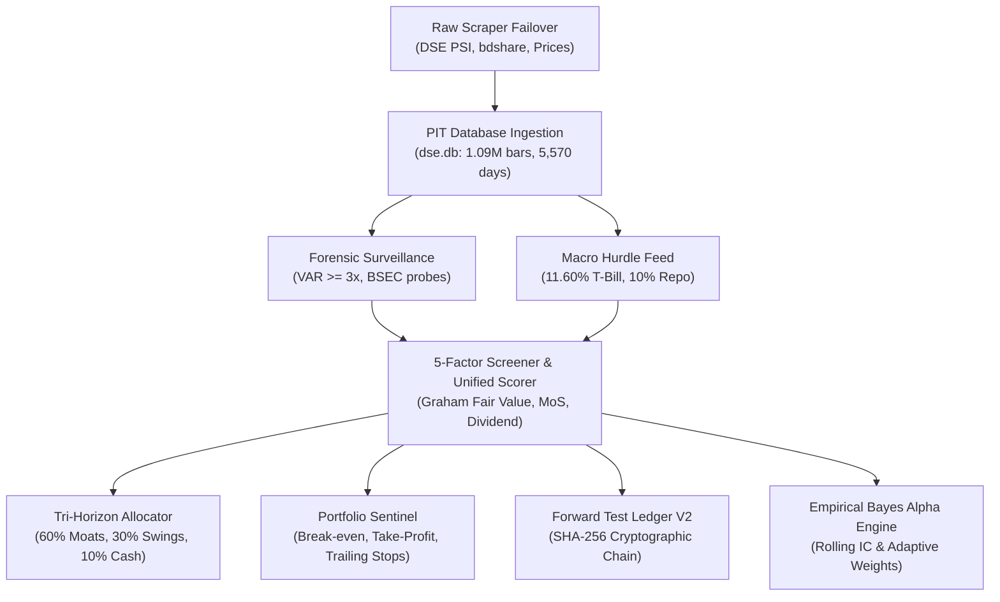

# 📜 MASTER SYSTEM SPECIFICATION: `stock_market_expert_bd`
**Version**: `2.0.0-PROD`  
**Standard**: Institutional Quantitative Frontier Market Protocol  
**Audit Baseline**: Score **95.2 / 100** (Grade: **A+**)  
**Last Verified**: 2026-11-02  

---

## 1. System Identity & Core Purpose

`stock_market_expert_bd` is an institutional-grade quantitative alpha generation, automated forensic risk surveillance, and algorithmic capital allocation engine built specifically for the frontier Dhaka Stock Exchange (DSE).

### 🏛️ The Subtractive Edge Mandate
In emerging equity markets, alpha is primarily subtractive. The system's primary directive is to eliminate the 90% toxic companies on the exchange:
1. **Loan-Service Traps**: Long-term borrowing destroyed by 12%–14% commercial bank lending rates in a 10.00% repo environment.
2. **Accrual / Paper Earnings**: Positive EPS accompanied by negative operating cash flow (NOCFPS < 0).
3. **Syndicate Pump-and-Dump Corners**: Illiquid junk stocks inflated by promoter social media channels without fundamental earnings.
4. **Governance & Regulatory Failures**: Companies facing BSEC investigation, receiver appointments, or sponsor share pledging.

Capital is strictly concentrated in **resilient, cash-covered moats** trading with a quantifiable **Graham Margin of Safety**.

---

## 2. Non-Negotiable System Invariants (Golden Rules)

Any agent, developer, or pull request modifying this codebase MUST respect these 8 invariants. Violating any invariant is considered a catastrophic architectural regression.

| Invariant ID | Name | Mandatory Rule & Verification Standard |
| :--- | :--- | :--- |
| **INV-1** | **Strict Point-in-Time (PIT) Isolation** | Financial statement data must NEVER be accessible prior to `tradable_date <= asof` AND `publication_date <= asof`. Future price perturbation must NEVER alter historical features or scores. |
| **INV-2** | **Central Bank Macro Hurdle Rate** | Minimum Equity Hurdle = 91-Day T-Bill Yield (**11.60%**) + 3.50% Equity Risk Premium (ERP) = **15.10%**. Uncompetitive stocks yielding below T-Bills are penalized. |
| **INV-3** | **100% Shariah / Halal & Zero-Bank Shield** | Banking stocks and conventional financial institutions are strictly blocked. Debt/Equity must be $\le 0.80$ (or $\le 0.50$ for strict tier). Zero exposure to debt default traps. |
| **INV-4** | **Frontier Microstructure Realism** | Lower circuit locks (-10% or -3%) have zero bid volume; exit execution MUST be deferred to liquid sessions. Next-session open fills, dynamic slippage (10–150 bps), and statutory fees (0.415% buy, 0.465% sell including Section 53BBB 0.05% AIT) must be enforced. |
| **INV-5** | **Frozen Champion Registry & Multi-Testing Deflation** | The serving model parameter hash is strictly locked to `acf502bc65914c48` (`frozen_epoch2_pit_v2`). Challengers must beat champion under Holm-Bonferroni family-wise error deflation and Newey-West $t > 2.0$. |
| **INV-6** | **Cryptographic Forward Test Ledger V2** | Real out-of-sample performance is tracked via SHA-256 block-chained forward test ledger (`forward_test_ledger_v2.json`). No hindsight alterations permitted. |
| **INV-7** | **Universal SQLite WAL & Concurrency Hardening** | Every SQLite database connection must pass `timeout=30.0` and execute `PRAGMA busy_timeout = 30000;` to prevent database locks in concurrent execution. |
| **INV-8** | **Zero-Broken Portable Bootstrap** | Any user on Windows, Linux, or macOS must be able to clone the repository (~35 MB) and bootstrap to a 100% operational state via `ready.bat` or `python scripts/bootstrap.py` in under 5 seconds. |

---

## 3. Core Feature Modules Specification

### 3.1 Scraping & Failover Subsystem ([`scripts/scraper.py`](file:///c:/Users/BS01671/Documents/stock_market/scripts/scraper.py))
- Multi-source fallback: `bdshare` $\rightarrow$ Next.js JSON API $\rightarrow$ Legacy HTML scraper $\rightarrow$ Local PIT snapshot.
- Price count gatekeeper: Requires $\ge 300$ active quotes to accept live session.

### 3.2 Point-in-Time Database Engine ([`scripts/processor.py`](file:///c:/Users/BS01671/Documents/stock_market/scripts/processor.py))
- Compares and compounds multi-year corporate actions (stock bonus splits, rights issues) backwards.
- Stores pure unadjusted price bars in `prices` table and financial disclosures in `fundamentals_pit`.

### 3.3 Forensic Surveillance Engine ([`scripts/anti_manipulation_engine.py`](file:///c:/Users/BS01671/Documents/stock_market/scripts/anti_manipulation_engine.py))
- Computes Volume Anomaly Ratio (VAR) against trailing 20-day median volume.
- Detects syndicate cornering in low-sponsor float companies (< 30% legal threshold).
- Maintains universal blacklist `is_ticker_blacklisted(ticker, asof_date)`.

### 3.4 5-Factor Fundamental Screener ([`scripts/five_factor_fundamental_screener.py`](file:///c:/Users/BS01671/Documents/stock_market/scripts/five_factor_fundamental_screener.py))
- Graham Fair Value Formula: $V = \sqrt{22.5 \times \text{EPS} \times \text{NAV}}$.
- Margin of Safety Formula: $\text{MoS} = \frac{V - P}{V} \times 100\%$.
- Cash Quality: Consolidated NOCFPS / EPS $\ge 0.75\times$.

### 3.5 Tri-Horizon Asset Allocator ([`scripts/recommender.py`](file:///c:/Users/BS01671/Documents/stock_market/scripts/recommender.py))
- **60% Long-Term Core Moats**: Multi-year compounding, cash dividends.
- **30% Mid-Term Cycle Swings**: +15% to +20% targets, -5% trailing stops.
- **10% Tactical Cash Reserve**: Dry powder buffer for deep RSI (< 25) panics.
- **Sector Concentration**: Maximum 2 stocks per industry sector.

### 3.6 Real-Time Portfolio Sentinel ([`scripts/portfolio_sentinel.py`](file:///c:/Users/BS01671/Documents/stock_market/scripts/portfolio_sentinel.py))
- Tracks exact break-even net of buy fee (0.415%) and sell friction (0.465%).
- Automated Profit-Taking: `TAKE_PROFIT_HALF` (+15%), `TAKE_PROFIT_ALL` (+30%).
- Lower circuit lockup detection: Defers liquidation on zero-bid floor locks.

### 3.7 Forward Test Ledger V2 ([`scripts/forward_test_ledger_v2.py`](file:///c:/Users/BS01671/Documents/stock_market/scripts/forward_test_ledger_v2.py))
- Out-of-sample deterministic portfolio tracking with SHA-256 cryptographic block chaining.
- Minimum rebalance cadence: 21 trading bars.

---

## 4. Multi-Agent Role Matrix (SpecMD Flow)

Development, testing, auditing, and acceptance are segregated into specialized agent personas:

| Agent Role | Skill Identifier | Primary Mission & Mandate |
| :--- | :--- | :--- |
| **Developer Agent** | `dse-developer` | Implements algorithms, refactors code, ensures PEP8, SQLite WAL timeouts, and strict backwards compatibility. |
| **Tester Agent** | `dse-tester` | Executes test harness (68/68 unit tests, 9/9 integrity checks), verifies zero-leakage, runs boundary and edge condition tests. |
| **Auditor Agent** | `dse-auditor` | Brutal third-eye institutional review. Detects lookahead bias, corporate action dilution, statistical p-hacking, and regulatory misalignment. Target score: $\ge 95.0$. |
| **User Proxy Agent** | `dse-user-proxy` | Acts as real-world market participant (৳1,000 retail trader, ৳50k swing trader, ৳1M HNWI). Validates usability, execution clarity, and bilingual Bengali reports. |

---

## 5. Specification Conformance Matrix

Every pull request or major commit must pass:
1. `python scripts/spec_guard.py` — Verifies all 8 non-negotiable invariants.
2. `python -m unittest discover -s tests -p "test_*.py"` — 100% passing.
3. `python scripts/integrity_harness.py` — 9/9 zero-failure pass.
