# 🏗️ System Architecture & Concurrency Model

The `stock_market_expert_bd` platform operates as a modular, 6-layer pipeline that transforms noisy raw market data into risk-screened capital deployment plans.

```mermaid
%%{init: {"flowchart": {"rankSpacing": 18, "nodeSpacing": 18, "subGraphTitleMargin": {"top": 4, "bottom": 4}}}}%%
flowchart TD
    subgraph L1["Layer 1: External Data Ingestion & Live Feeds"]
        DSE["DSE Live / bdshare API<br/>(395 Instruments, OHLCV)"]
        BB["Bangladesh Bank Rates<br/>(91d T-Bill 11.60%, Repo 10%)"]
        PSI["DSE PSI & News Feeds<br/>(Dividends, AGM, EPS, Reg 19/16)"]
    end

    subgraph L2["Layer 2: Storage & Point-in-Time (PIT) Normalization"]
        WAL["Universal SQLite WAL Engine<br/>(data/processed/dse.db)"]
        PIT["Point-in-Time Ledger<br/>(tradable >= publication >= snapshot)"]
        CAL["DSE Trading Calendar<br/>(3,652 Sessions, Gap Recovery)"]
    end

    subgraph L3["Layer 3: Forensic Surveillance & Shariah Gatekeeper"]
        SURV["Forensic Anti-Manipulation Engine<br/>(VAR >= 3x, Corwin-Schultz Spread)"]
        HALAL["Halal Guard & Balance Sheet Screen<br/>(Debt/Equity <= 0.8, Haram Exclusions)"]
        DEBT["High-Interest Trap Filter<br/>(NOCFPS <= 0, 14% Commercial Debt)"]
    end

    subgraph L4["Layer 4: Quantitative Valuation & Multi-Factor Engine"]
        GRAHAM["12-Factor Graham/Buffett Screener<br/>(Fair Value, MoS, ROE, Margin Moats)"]
        HURDLE["Central Bank Equity Risk Hurdle<br/>(Earnings Yield >= T-Bill + 350 bps)"]
        BAYES["Bayesian Walk-Forward Model<br/>(Empirical Bayes Weight Shrinkage)"]
    end

    subgraph L5["Layer 5: Portfolio Allocation & Risk Sentinel"]
        PARITY["Risk-Parity Volatility Targeting<br/>(Inverse Volatility & 3-Tier Tranches)"]
        SENTINEL["Real-Time Execution Sentinel<br/>(Floor Price Guard, Circuit Breakers)"]
        HORIZON["Tri-Horizon Asset Allocator<br/>(60% Core, 30% Swings, 10% Cash)"]
    end

    subgraph L6["Layer 6: Verification & Cryptographic Ledger"]
        SPEC["Spec Guard (8 Invariants)<br/>(Universal Conformance Engine)"]
        LEDGER["Cryptographic Forward Ledger<br/>(SHA-256 Hash-Chained Blocks)"]
    end

    L1 --> L2
    L2 --> L3
    L3 --> L4
    L4 --> L5
    L5 --> L6
```



---

## 🏛️ Storage Engine & Universal SQLite WAL Mode

The system relies on an embedded SQLite database (`data/processed/dse.db`) optimized for high read concurrency:

1. **Universal WAL Mode**: Executed on every database connection:
   ```sql
   PRAGMA journal_mode = WAL;
   PRAGMA synchronous = NORMAL;
   PRAGMA busy_timeout = 30000;
   ```
2. **30-Second Busy Timeout**: Prevents multi-process crashes when background scrapers write while analysis scripts read.
3. **Compressed Distribution**: The full database is committed as a compressed archive `data/processed/dse.db.gz` (30.8 MB) containing 1,093,326 continuous price bars and 1,707 PIT filing records. On initialization, `bootstrap.py` decompresses it in ~2 seconds.
